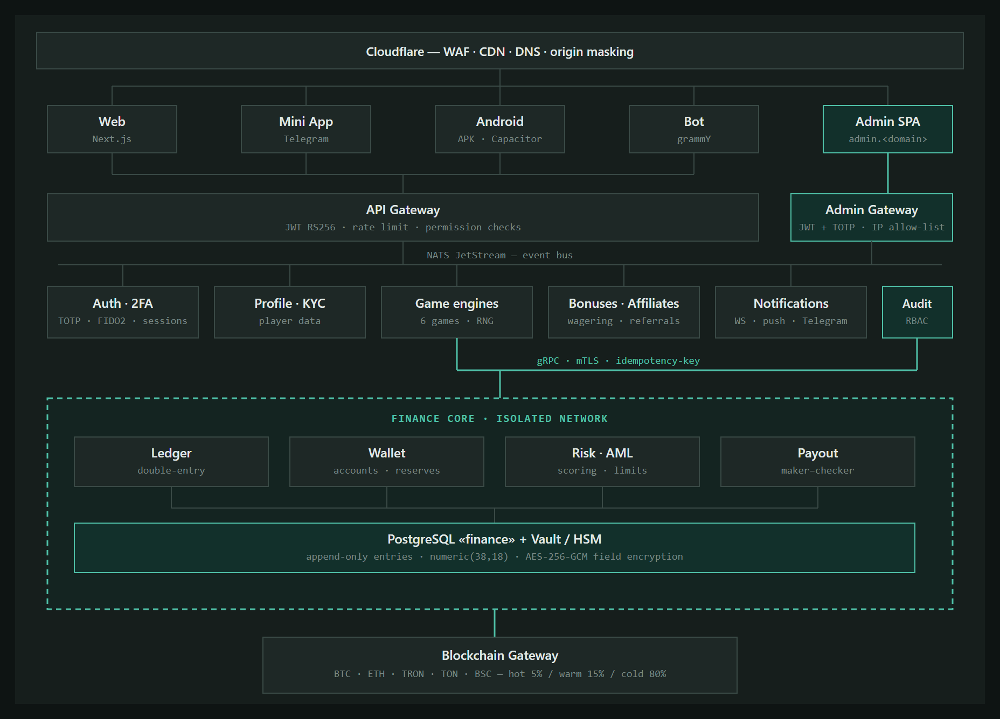

# Architecture

The client calls PostTransaction over mTLS. The server replaces the request actor with the authenticated certificate identity, sorts postings, checks currency and scale and signs the canonical digest. The store writes the header, journal rows, balance cache and audit link in one database transaction.

PostgreSQL runs the application as a member of ledger_service. Database initialization uses a separate owner. The pgx pool supplies database/sql connections so the two backends share one posting implementation. The verifier opens a consistent snapshot and recomputes account balances and signatures.

The supplied platform diagram places Ledger inside the finance network. Its database type, Vault/HSM, wallet, games and blockchain gateway describe the surrounding design. This repository implements the ledger with integer minor units and a local Ed25519 signer. Compose exposes its two listeners on loopback.

## Design decisions

1. [Append-only entries](adr/0001-append-only.md)
2. [Integer amounts and account scale](adr/0002-minor-units.md)
3. [Replay semantics](adr/0003-idempotency.md)
4. [Transaction signatures and audit history](adr/0004-audit.md)
5. [Writer concurrency](adr/0005-locks.md)
